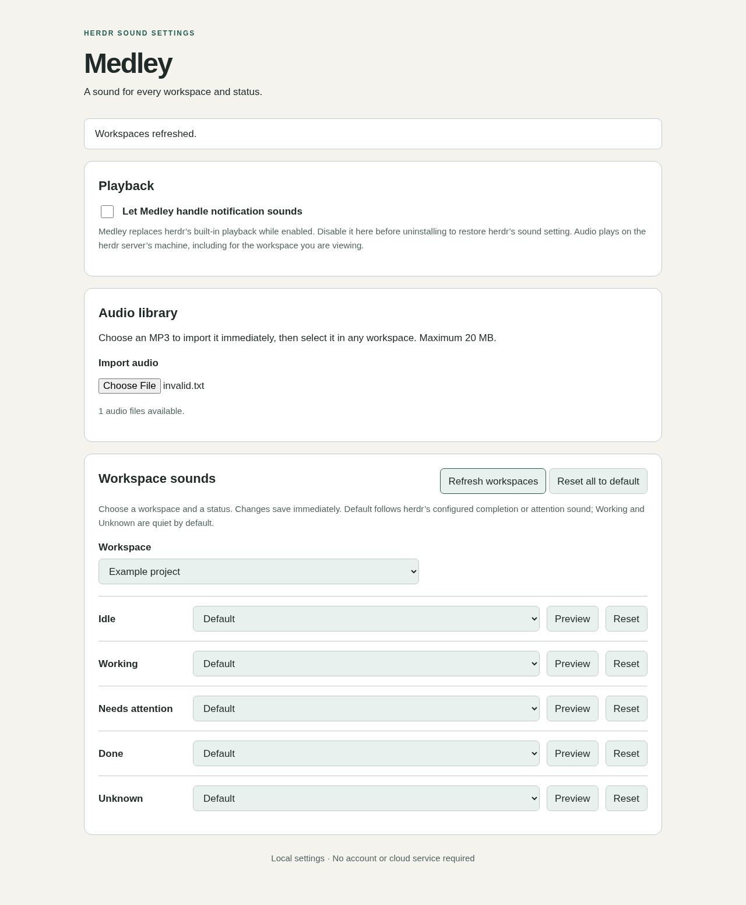

# Medley

Choose an audio file for each **herdr workspace × status**. Import MP3s into a reusable library, preview a choice, select **None** for quiet, or reset one choice or all choices to default.

Medley is a local herdr plugin for Linux and macOS. Python 3.11+ and herdr 0.9.1+ are required. Install **ffmpeg** for MP3 validation and Linux playback; macOS uses `afplay` for playback and still requires ffmpeg for importing.

## Install

```sh
herdr plugin install dreinecke/medley
herdr plugin action invoke medley.settings
```

In settings, enable **Let Medley handle notification sounds**. This disables herdr's native sound playback to prevent duplicates. Turning Medley off restores the previous native sound-enabled setting. No herdr server restart is needed.

For a local checkout:

```sh
git clone https://github.com/dreinecke/medley.git
cd medley
herdr plugin link . --enabled
python3 medley.py settings
```

The settings command prints a private localhost URL and opens it in your browser. Keep that command running while editing; Ctrl+C closes the settings server. Sound rules continue working through herdr's event hooks after settings closes. A refresh in the browser preserves its access token in tab session storage.

## Choose your sounds

1. Choose an MP3, up to 20 MB; it imports immediately without another button press. Medley validates the audio and copies it into its private library, so moving or deleting the original does not break playback.
2. Choose a workspace. Each of its five statuses has a separate audio selection.
3. Select a library file (displayed without its .mp3 extension), **None · quiet**, or **Default**. Changes save immediately.
4. Use **Preview** to play the selected sound immediately in your browser. The audio controls remain available to stop or replay it. Silent selections are identified as quiet; if the browser blocks playback, use Play in the controls to retry. **Reset** restores one cell; **Reset all to default** restores every workspace and offers Undo until settings closes or another reset replaces it.

The statuses are Idle, Working, Needs attention (herdr's `blocked`), Done, and Unknown. Rules use herdr's workspace IDs, so renaming a workspace retains its choices. Recreating a deleted workspace or using a different herdr session does not transfer choices automatically. Keep a separate plugin config directory per independent session.

A workspace may contain several agents. Medley reads herdr's **combined workspace status** after a pane status event and plays once when that combined status changes. Duplicate pane events do not repeat the sound. The first observation of a new workspace is silent. Rapid transitions that have already disappeared before the hook reads current state are coalesced.

Default follows herdr's configured `done_path` / `request_path`, then `path`. If no usable custom file exists, Medley uses herdr's bundled completion or attention clip. Idle and Done use completion; Needs attention uses attention; Working and Unknown are quiet. Explicit selections can add audio to any status.

## Where audio plays

Plugin hooks run on the **herdr server machine**, so audio plays there, including for the currently focused workspace. This release does not route sound to remote clients or mirror herdr's focused-tab suppression. It is suitable for a local desktop server; do not enable it on a remote server expecting your laptop to play audio. Playback is bounded to 30 seconds per clip; overlapping notifications are dropped while a clip is playing. Very long MP3s may be interrupted.

The audio library and mappings stay outside the checkout under herdr's plugin config directory (`herdr plugin config-dir medley`). Only local files are read. No account, telemetry or cloud upload is involved. The browser uses a random bearer token and a loopback-only HTTP server. Treat the printed settings URL as private.

## Disable or uninstall

**First turn off Medley in its settings**, or run the following from the checkout using the same plugin config environment:

```sh
python3 medley.py disable
herdr plugin unlink medley
```

Unlinking or disabling the plugin directly cannot restore herdr's muted sound setting automatically. The original config backup is `herdr-config-before-medley.toml` in Medley's config directory; disabling normally changes only `ui.sound.enabled`, preserving subsequent unrelated edits. To recover manually, set `[ui.sound] enabled = true` in herdr's config and run `herdr server reload-config`.

## Develop

```sh
python3 -m unittest discover -s tests -v
python3 medley.py settings --no-browser
```

There are no Python package dependencies. See [architecture](docs/architecture.md), [validation](docs/validation.md), and [third-party notices](NOTICE).

Licensed under Apache-2.0.

## Preview



Browser validation is optional developer tooling: `npm ci && npx playwright install chromium && npm test`. Runtime needs no npm packages.
